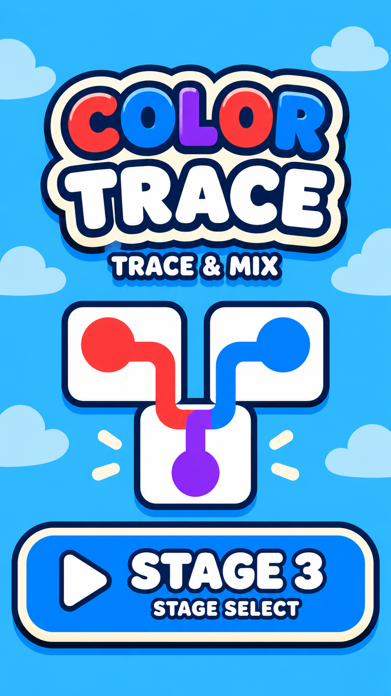
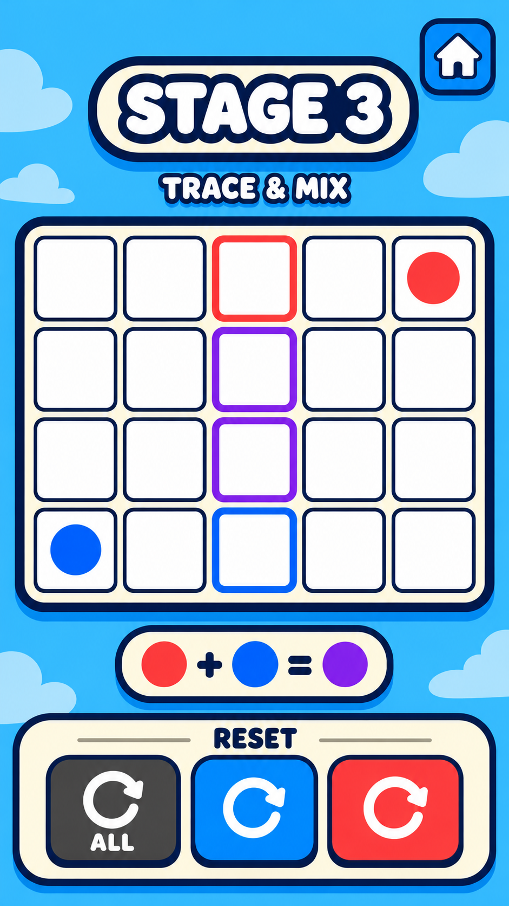
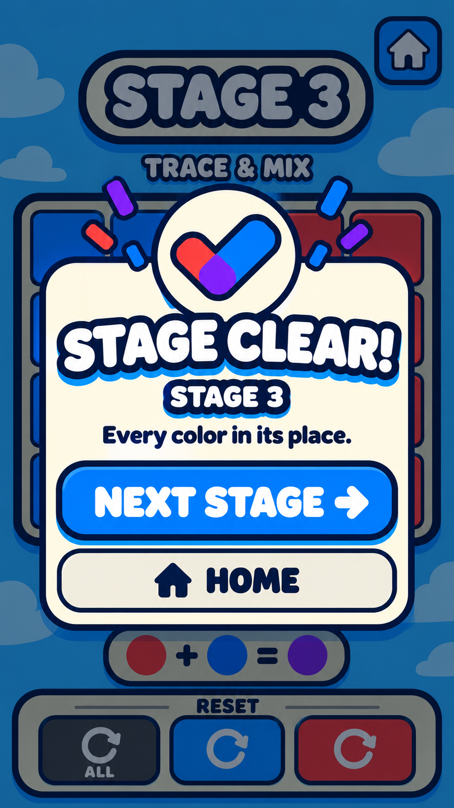

# 採用デザイン：2D B / Toon Bold（ポップ）

採用日: 2026-10-24（日本時間）

ユーザー指定により、青空背景・太い濃紺の輪郭線を持つ「2D B：ポップ」を採用します。タイトル・ステージ・クリアの3画面は、このデザインを共通の基準にします。

## 採用する3画面

| タイトル | ステージ | クリア |
|---|---|---|
|  |  |  |

## 共通のデザイン方針

- 青空色の背景、クリーム色のパネル、濃紺の太い輪郭線。
- 大きく丸い文字、角丸のタイル・ボタン、くっきりしたグラフィックの影。
- 赤・青・紫のゲーム上の色を全画面で共通に使用。
- タイトルは現在のステージへ進むボタンを1つ配置。
- ステージは5列×4行、混色ガイド、ホーム、ALL・青・赤のリセット。
- クリアはNEXT STAGEを主ボタン、HOMEを副ボタンとする。

画像内のSTAGE 3は表示例です。実際の表示番号はゲームの進行に合わせます。

## 生成プロンプト

- [タイトル](title-clear/02-2d-toon-bold-title-prompt.txt)
- [ステージ・初回生成](02-2d-toon-bold-prompt.txt) / [仕上げの編集](02-2d-toon-bold-refinement.txt)
- [クリア](title-clear/02-2d-toon-bold-clear-prompt.txt)

[全12画面の比較](title-clear/index.html) / [採用情報JSON](selection.json)
