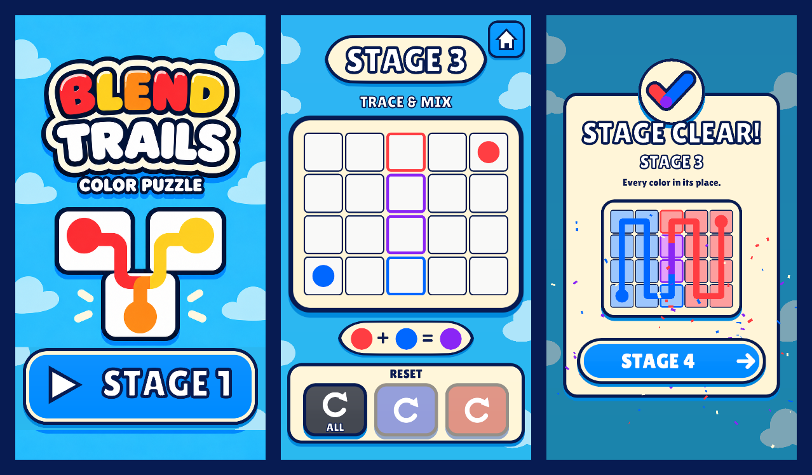

# Blend Trails: Color Puzzle — UI修正

2026-10-25（Asia/Tokyo）

追加修正：進行情報をStage1・問題1・直近履歴0へリセット。クリア画面のボタンはNEXT STAGEから、次に進むStage番号の表示へ変更。例：Stage3クリア時はStage4、Stage30クリア時はStage31。画像一覧も現在の仕様へ更新。

今回の変更はクリア演出・番号表示の2件と、全30ステージから継続ステージまでの遷移テスト1件が通過。撮影後にもStage1・問題1・直近履歴0を保存し直して確認。今回の検証結果は `output/ui-stage-label-reset/validation-summary.json`。

## 反映内容

- リセット矢印：円弧の先端と矢じりを連結し、端を丸めた形状へ修正。
- 盤面の外枠：全30ステージで横0.7・縦0.9ユニットの余白を加え、四隅のタイルと外枠の重なりを解消。タイルの条件・位置関係・操作は維持。
- ステージクリア：添付イメージに合わせたクリーム色のカード、混色チェックマーク、STAGE CLEAR!、ステージ番号、次に進むStage番号のボタンを配置。HOMEなし。完成した実盤面を着色・線とともに60%縮小してカード内に表示。
- タイトル：正式名「Blend Trails: Color Puzzle」のロゴへ差し替え。承認された赤＋黄＝オレンジの構成を継承。

## 実画面

[一覧を開く](index.html)

941×1672と941×2039でクリアカードとボタンのSafe Area内への配置を確認。実プレイで20タイルの正解、完成盤面の60%縮小、Stage4ボタンのヒット判定と遷移、3配色を確認。

## 検証

- EditMode：48件通過。
- PlayMode：49件通過。全体実行で48件通過後、NEXT STAGEへの表示変更を反映した遷移テスト1件を再実行して通過。全30ステージと31以降の継続プレイまで確認。
- クリア演出の中断時に盤面・操作・カード表示が復元されることを確認。
- 検証前の進行状態とEditorの表示サイズ・シーンを復元。

生の結果は `editmode-status.json`、`playmode-status.json`、`playmode-navigation-status.json`。集計は `validation-summary.json`、実プレイ確認は `manual-checks.json`。

## ロゴ素材

ビルトイン画像生成ツールを使用し、元の承認画像を編集。元画像を保存したまま新素材をプロジェクトへ追加。

- 新素材：`Assets/UI/ToonBold/BlendTrailsTitle.png`
- 元画像：`Assets/UI/ToonBold/ApprovedTitle.png`
- [使用した生成プロンプト](title-logo-prompt.txt)

再適用はUnityメニュー **Color Puzzle / Apply B Toon UI To All Screens**。
